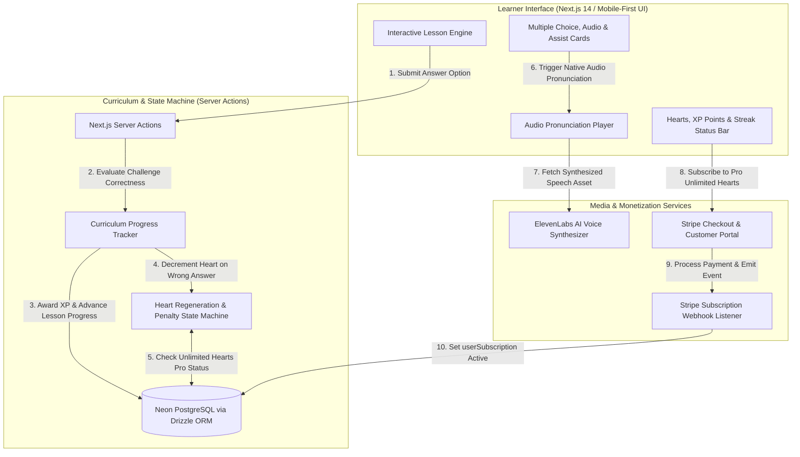

<div align="center">

# GNTI | Lumina

<p><strong>Gamified Adaptive Learning Platform with Spaced Repetition, Streaks, Hearts & Audio Pronunciation</strong></p>

<p>A flagship production foundation engineered by <a href="https://gnti.tech">Galaxy Nova Technologies & Innovations (GNTI)</a>.</p>

<p>
  <a href="https://gnti.tech"></a>&nbsp;
  <a href="https://github.com/GNTI-X/lumina"></a>&nbsp;
  <a href="./LICENSE"></a>&nbsp;
  <a href="https://gnti.tech/projects/lumina"></a>
</p>

</div>

---

## 📌 1. System Overview

**Lumina** is a gamified educational platform engineered to maximize learner engagement and retention through behavioral psychology mechanisms. Drawing inspiration from Duolingo's proven pedagogical architecture, Lumina integrates structured modular curricula (Courses $
ightarrow$ Units $
ightarrow$ Lessons $
ightarrow$ Challenges) with interactive feedback loops, spaced repetition algorithms, and retention stakes.

The platform incorporates a **Hearts System** (where errors deplete hearts, requiring deliberate practice to regenerate), a **Streak Engine** (rewarding daily consistency), XP point ladders, and animated sound-assisted interactive quizzes. Premium subscribers can unlock unlimited hearts and premium content tiers via integrated Stripe billing.

---

## 🏛 2. Architecture & System Flow

### System Architecture Diagram



### End-to-End Workflow

1. **Curriculum Navigation**:
   - The learner selects a course (e.g. Spanish, French).
   - Lumina loads the curriculum tree: Units are unlocked sequentially based on prerequisite lesson mastery recorded in `userProgress`.
2. **Interactive Challenge Evaluation**:
   - During a lesson, users answer varied challenges: `SELECT` (choose correct card), `ASSIST` (fill in blanks / translations), and `LISTEN` (audio comprehension).
   - Correct answers trigger celebratory audio cues and increment points (XP).
   - Incorrect answers trigger error sound effects, animate screen shake, and decrement one heart.
3. **Hearts & Retention Mechanics**:
   - Free users start with 5 hearts. When hearts hit zero, active lessons pause, prompting the user to either review completed material in "Practice Mode" to restore hearts or upgrade to Pro.
4. **Stripe Pro Subscription**:
   - Users can purchase Lumina Pro for unlimited hearts and full course access.
   - Stripe Webhooks automatically synchronize subscription status (`userSubscription` table) with instant feature unlocks.

---

## 🛠 3. Categorized Tech Stack

| Domain | Technology | Purpose |
|:---|:---|:---|
| **Frontend Framework** | `Next.js 14` & `React` | Mobile-first gamified learning interface with responsive layouts |
| **Database & ORM** | `PostgreSQL` (Neon) via `Drizzle` | Hierarchical curriculum tables and user progression tracking |
| **Authentication** | `Clerk` | User registration, social sign-ins, and session tokens |
| **Voice Synthesis** | `ElevenLabs API` | High-fidelity native speech pronunciation for language challenges |
| **Payments & Billing** | `Stripe` (`stripe`, `@stripe/stripe-js`) | Checkout sessions, billing portal, and recurring Pro subscriptions |
| **Audio & Animation** | `Howler.js`, `Canvas-Confetti` | Interactive sound effects and celebratory particle bursts |
| **Styling** | `Tailwind CSS`, `Shadcn UI` | Playful, accessible component design system with KennyNL graphics |

---

## 🗄 4. Domain Data Model & Entity Relationships

```
courses (1) ───< units (many) ───< lessons (many) ───< challenges (many) ───< challengeOptions (many)
```

- **`courses`**: `id`, `title`, `imageSrc`
- **`units`**: `id`, `title`, `description`, `courseId` (FK), `order`
- **`lessons`**: `id`, `title`, `unitId` (FK), `order`
- **`challenges`**:
  - `id`, `lessonId` (FK), `type` (Enum: `SELECT`, `ASSIST`), `question`, `order`
- **`challengeOptions`**:
  - `id`, `challengeId` (FK), `text`, `correct` (boolean), `imageSrc`, `audioSrc`
- **`userProgress`**:
  - `userId` (Primary Key), `userName`, `userImageSrc`, `activeCourseId` (FK), `hearts` (0-5), `points` (XP)
- **`userSubscription`**:
  - `id`, `userId` (unique), `stripeCustomerId`, `stripeSubscriptionId`, `stripePriceId`, `stripeCurrentPeriodEnd`

---

## 🔑 5. Environment Variables Reference

| Variable | Required | Description |
|:---|:---:|:---|
| `DATABASE_URL` | **Yes** | PostgreSQL connection string |
| `NEXT_PUBLIC_APP_URL` | **Yes** | Web application origin URL (`http://localhost:3000`) |
| `NEXT_PUBLIC_CLERK_PUBLISHABLE_KEY` | **Yes** | Clerk publishable authentication key |
| `CLERK_SECRET_KEY` | **Yes** | Clerk private backend secret |
| `STRIPE_API_KEY` | **Yes** | Stripe secret API key |
| `STRIPE_WEBHOOK_SECRET` | **Yes** | Stripe webhook signing secret |
| `ELEVENLABS_API_KEY` | Optional | ElevenLabs API key for AI pronunciation |

---

## 🚀 6. Local Development & Deployment

```bash
# 1. Clone repository
git clone https://github.com/GNTI-X/lumina.git
cd lumina

# 2. Configure environment
cp .env.example .env

# 3. Install dependencies
npm install

# 4. Push Database Schema & Seed Curriculum
npm run db:push
npm run db:seed

# 5. Run development server
npm run dev
```

---

## 🏢 About GNTI

Galaxy Nova Technologies & Innovations (GNTI) builds and deploys scalable software across multi-tenant SaaS, real-time communication, AI automation, and media streaming infrastructure.

- **Website**: [gnti.tech](https://gnti.tech)
- **Official Specification**: [gnti.tech/projects/lumina](https://gnti.tech/projects/lumina)
- **Inquiries**: [contact@gnti.tech](mailto:contact@gnti.tech)

---

## 📄 License

Distributed under the **MIT License**. See [LICENSE](./LICENSE) for details.

Copyright &copy; 2026 [Galaxy Nova Technologies & Innovations (GNTI)](https://gnti.tech). All rights reserved.
